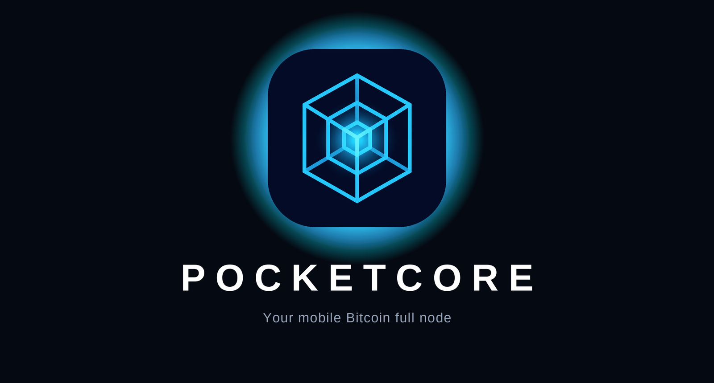
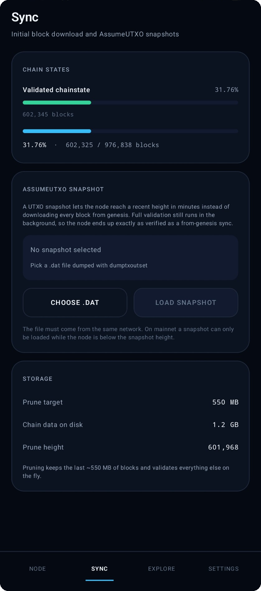
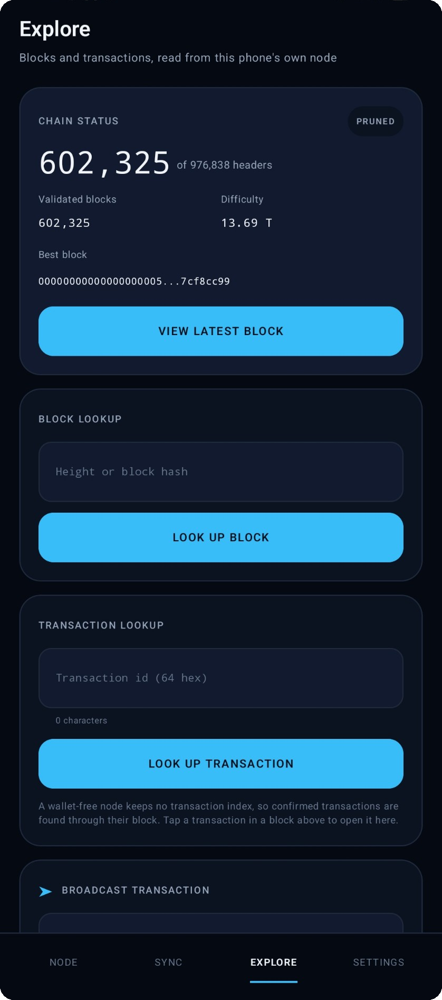
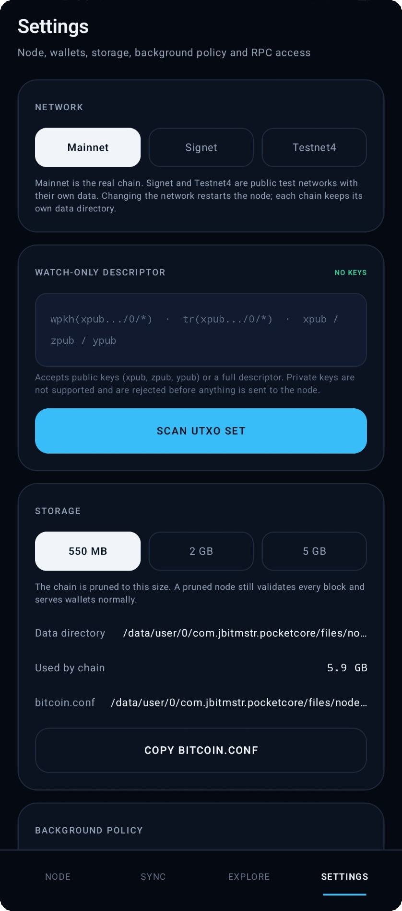

**A real Bitcoin Core full node in your pocket. Every block checked by SHA-256d and libsecp256k1 on your own phone — no wallet, no accounts, no servers, no fake node.**

<p>
  <a href="https://github.com/CoreJBH/pocketcore/releases/latest"></a>
  
  
  
  
  
  
  
</p>

POCKETCORE bundles an actual `bitcoind` (Bitcoin Core 32.1) cross-compiled for
Android arm64, runs it from the app's own native library directory, and talks to
it over loopback JSON-RPC. Nothing about the verification is re-implemented in
Kotlin and nothing is delegated to a server: proof-of-work, Merkle roots, script
execution and every ECDSA/Schnorr signature check run inside the unmodified
Bitcoin Core source, built for `aarch64-linux-android`, on the device in your
hand.

**Download.** Grab `pocketcore.apk` from
[Releases](https://github.com/CoreJBH/pocketcore/releases/latest) and install it
(allow "install unknown apps" for the app you open it with). Every build shares
one debug signing key, so a newer APK installs straight over the installed one —
update in place rather than uninstalling, because removing the app deletes its
node data (headers, blocks, settings) with it.

---

## Cryptography

Bitcoin is checked at four layers, and the phone does all four itself.

| Primitive | What runs on the phone | What it decides |
| --- | --- | --- |
| **SHA-256d** | double SHA-256 over the 80-byte header, transaction ids/wtxids, and every Merkle node (`src/hash.h`, `src/crypto/sha256.cpp`) | the block hash, the txid and the Merkle root are what the daemon computed, not what a peer claimed |
| **Proof of work** | the block hash compared against the target decoded from `nBits`, and the chainwork accumulated per header | a header is only accepted if enough work stands behind it; the best chain is the one with the most work, never the one a peer prefers |
| **libsecp256k1** | ECDSA over secp256k1 (DER) and BIP340 Schnorr (64-byte signatures, x-only public keys) for taproot, plus BIP32 child-key derivation for descriptors | a spend is valid only if every signature in its script actually verifies |
| **Script interpreter** | P2PKH, P2SH, P2WPKH, P2WSH, P2TR; BIP143 and BIP341 sighash; `OP_CLTV`, `OP_CSV`, multisig and the rest | the UTXO being spent is locked to this exact script and this exact transaction |
| **BIP324 v2 transport** | BIP324's ElligatorSwift x-only ECDH handshake and ChaCha20-Poly1305 AEAD session per peer | traffic to peers is encrypted and authenticated, so a passive observer no longer reads every block and transaction you relay |

`libsecp256k1` is Bitcoin Core's own vendored subtree, compiled statically into
`libbitcoind.so`. There is no JNI signature code, no Pure-Java elliptic curve
and no remote verifier anywhere in the APK: if the curve code were wrong, the
node would reject valid blocks and stall, which is the one failure mode a node
operator notices immediately.

**Watch-only means no keys.** POCKETCORE derives addresses from a public
descriptor (`wpkh`, `tr`, `sh(wpkh)`, `pkh`, or a bare xpub/zpub/ypub) and asks
the node's UTXO set for matches with `scantxoutset`. A `scantxoutset` result is
not a balance from an API — it is the daemon scanning its own validated UTXO set
for the `scriptPubKey`s those derived keys produce. Private keys, WIF strings and
seed phrases are refused before they reach the node, and the daemon is compiled
with `ENABLE_WALLET=OFF`, so there is no key store to fill even if someone tried.

**Nothing leaves the phone.** The daemon's only network traffic is its own P2P
connections; RPC binds to `127.0.0.1` with a generated user and password and is
never exposed to the LAN. `network_security_config.xml` allows cleartext HTTP to
`127.0.0.1` and `localhost` only; every other destination is HTTPS-only, and the
app makes no requests of its own.

## Screens

Every figure on these screens is an RPC answer from the phone's own node.

<table>
  <tr>
    <td align="center" width="25%"></td>
    <td align="center" width="25%"></td>
    <td align="center" width="25%"></td>
    <td align="center" width="25%"></td>
  </tr>
  <tr>
    <td align="center"><sub><b>NODE</b></sub></td>
    <td align="center"><sub><b>SYNC</b></sub></td>
    <td align="center"><sub><b>EXPLORE</b></sub></td>
    <td align="center"><sub><b>SETTINGS</b></sub></td>
  </tr>
  <tr>
    <td align="center" colspan="4"></td>
  </tr>
  <tr>
    <td align="center" colspan="4"><sub>The colorized foreground-service status card while the chain downloads</sub></td>
  </tr>
</table>

## What it does

- **Real daemon, real chain.** The APK ships `libbitcoind.so`, an unmodified
  Bitcoin Core 32.1 `bitcoind` built for `aarch64-linux-android` with the Android
  NDK. It is extracted into `nativeLibraryDir` at install time and executed as a
  child process of a foreground service.
- **Signature checks in your pocket.** Every block the phone accepts has had its
  proof of work checked, its Merkle root rebuilt, its scripts executed and its
  ECDSA or Schnorr signatures verified by `libsecp256k1` — on the phone's own
  CPU, while the app shows the height climbing.
- **Wallet-free by design.** Built with `ENABLE_WALLET=OFF`; the node validates,
  stores and serves the chain, and leaves keys to the wallet you already use.
- **Live dashboard from RPC.** Block height and header height, sync percentage,
  chain state, peers in/out, mempool transaction count and memory, pruned chain
  size and prune height, uptime, difficulty, subversion, best block hash.
- **Peers with offline country flags.** Every connected peer shows its flag,
  `ip:port`, subversion, advertised services, ping and connection age, with one
  tap to disconnect or ban it for 24 hours. The country table is bundled inside
  the APK, so no address is ever sent to a GeoIP service.
- **Chain explorer.** Look up any block by height or hash (`getblockhash`,
  `getblockheader`, `getblock 2`) with size, weight, merkle root, nonce and its
  transaction list; pruned blocks still show their verified header. Look up a
  transaction by id, or tap one inside a block.
- **Raw transaction broadcast.** Paste (or paste multi-line) signed hex and send
  it with `sendrawtransaction`; the app shows the resulting txid with a copy
  button, or the exact rejection reason bitcoind returned.
- **Watch-only descriptors.** Paste a `wpkh`/`tr`/`sh(wpkh)`/`pkh` descriptor or
  a bare xpub/zpub/ypub and scan the UTXO set with `scantxoutset`: confirmed
  balance, addresses and unspent outputs, with no wallet database and no private
  key. Private keys and WIF are refused before anything reaches the node.
- **Local JSON-RPC, kept out of sight.** The daemon listens on `127.0.0.1` and
  authenticates this app only. The RPC pair is generated on the device, sealed
  with an Android Keystore key and never shown, copied or written in the clear:
  `bitcoin.conf` carries a salted `rpcauth` hash, not the password.
- **Two controls on the node screen.** START and STOP, a block-height card, the
  peer list and one node card - nothing that asks the user to handle a
  credential.
- **Pruned or full mobile storage.** Default `prune=550`, switchable to 2048 MB,
  5120 MB or `Full` (`prune=0`, every block kept: about 750-800 GB on mainnet). A
  pruned node still validates every block.
- **AssumeUTXO.** Load a `dumptxoutset` `.dat` file to jump to a recent height in
  minutes; background validation continues from genesis, and both chainstates are
  shown with their own progress.
- **Network selector.** Mainnet (default), Signet and Testnet4, each with its own
  data directory and ports.
- **Background policy.** "Wi-Fi only" and "Charging only" pause the node (graceful
  `stop` RPC) and start it again when the condition returns.
- **Calm launch screen.** A 1.1 s midnight-navy splash: the tesseract mark
  settles once from 95% at full opacity, holds, and fades into the dashboard.
  The cyan halo behind the tile is one radial gradient drawn by the whole
  window and reaches full transparency 150dp out, so no box edge ever clips it.
- **Colorized status card.** The foreground service notification is a colorized
  card in the app's own blues, laid out like the node apps it is compared with:
  one small icon on the left (no large icon, so no second icon on the right), the
  state (`Fully synced`, `Syncing`, `Pre-syncing`, `Waiting for Wi-Fi`, `Paused`)
  in the header row between the app name and the time of the last RPC reply, and
  a single content line. `Synced - Block #<height>` on opaque ocean blue
  (`#0369A1`) once caught up, `<percent> - Block #<height>` on deep cobalt
  (`#1E3A8A`) with a live progress bar while the chain downloads, and dark
  slate-navy (`#0F172A`) while paused. While Core is still downloading headers
  the card shows Core's own header percentage, read from `debug.log`, because RPC
  reports `headers: 0` and `0.00%` until the header chain is committed.
- **Midnight navy UI.** `#050912` canvas, `#0B1220` cards, `#1E293B` hairlines, a
  cyan-blue `#38BDF8` accent and monospaced tabular figures. Four tabs:
  `NODE`, `SYNC`, `EXPLORE`, `SETTINGS`; the debug log opens from SETTINGS.
- **Resilient startup.** Before the daemon starts, the app verifies its RPC and
  P2P ports, stops an orphan node left behind by a killed app process (through
  its own RPC credentials), and moves to a free port when another app holds the
  default one. Bitcoin Core treats a busy RPC port as fatal, so this app never
  hands the daemon an endpoint it has not checked.

## Architecture

```
Compose UI  (NODE · SYNC · EXPLORE · SETTINGS)
      |  StateFlow
NodeController  ——  NodeService  (foreground service, colorized status card)
      |                   |
      |                   +— Wi-Fi only / charging only  ->  stop, start
      +— RpcClient  —— HTTP JSON-RPC on 127.0.0.1, generated user + password
                              |
                              v
                        bitcoind child process
                        (libbitcoind.so executed from nativeLibraryDir)
                              |  BIP324 v2 P2P to the network
                              v
                        <app files>/node/data   pruned chain, debug.log, .lock
```

The app is a thin, honest client: it never parses the P2P wire format or the
block serialization itself. Every figure on screen — height, headers, peers,
mempool, block, transaction, UTXO set — is an RPC answer the daemon gave, and
every control on screen is an RPC call. That separation is deliberate: the UI
cannot claim a block is valid, because the UI has no opinion about validity at
all. `NodeController` owns the state, polling and the Wi-Fi/charging policy;
`NodeService` keeps the process alive and paints the status card; the daemon
itself is untouched Bitcoin Core, and the cryptography in the table above is
Core's own code, compiled for this phone.

## Project layout

```
app/src/main/java/com/jbitmstr/pocketcore/
  MainActivity.kt              Compose host, notification permission
  core/
    NodePaths.kt               datadir, conf, logs, snapshot directory
    NodeConfig.kt              bitcoin.conf generation (rpcauth, prune, ports)
    NodeSettings.kt            persisted settings + generated RPC credentials
    SecretStore.kt             Keystore-sealed storage for the RPC password
    RpcAuth.kt                 rpcauth salt + HMAC-SHA256 for bitcoin.conf
    ProcScan.kt                /proc reads: UID and argv of our own processes
    PortResolver.kt            which port a start gets and who may be asked to stop
    VersionProbe.kt            daemon version with a writable HOME
    RpcClient.kt               loopback JSON-RPC client
    NodeModels.kt              getblockchaininfo / getnetworkinfo / ... models
    BitcoindNode.kt            child process lifecycle, stray process cleanup
    NodeController.kt          single source of truth: state, polling, policy
    NodeService.kt             foreground service, notification, receivers
    NotificationCard.kt        status card wording and colours (unit-tested)
    PortProbe.kt               free-port selection before the daemon starts
    SystemState.kt             Wi-Fi and charging checks
    HeaderSync.kt              header pre-sync percentage read from debug.log
    ExplorerController.kt      block / transaction lookup, broadcast
    ExplorerModels.kt          block, header and transaction models
    RawTransaction.kt          signed hex normalisation before broadcast
    Descriptors.kt             watch-only descriptor validation
    DescriptorScanController.kt  scantxoutset scan, progress, abort
    AddressCodec.kt            scriptPubKey hex -> base58 / bech32 / bech32m
    GeoIp.kt, IpCountryIndex.kt  offline peer country table
  ui/                          Compose screens: Node, Sync, Explore, Settings
  ui/SplashScreen.kt           midnight-navy launch overlay
app/src/main/jniLibs/arm64-v8a/libbitcoind.so   the real Bitcoin Core daemon
app/src/main/assets/ipv4_country.bin            offline IPv4 -> country ranges
tools/                         icon, screenshot, GeoIP asset and RPC verification scripts
verify-english.py              fails if any non-English text enters the repo
```

## Requirements

- Android 8.0 (API 26) or newer, `arm64-v8a` device
- About 1 GB free storage for the default pruned chain plus the app
- A Wi-Fi connection for the initial sync (mobile data is allowed unless
  "Wi-Fi only" is on)

## Install

1. Download `pocketcore.apk` from
   [Releases](https://github.com/CoreJBH/pocketcore/releases/latest) and copy it
   to the phone, or build it yourself with `./gradlew :app:assembleDebug`.
2. Allow "install unknown apps" for the app you open it with, then install.
3. Open POCKETCORE and press **START NODE**. The foreground notification shows
   the current height while the node syncs.

All builds are signed with the same debug key (certificate SHA-256
`f5074815...2aa9c011`, unchanged since versionCode 2), so a newer APK installs
over the installed one as an update and keeps the synced chain. Do not uninstall
to upgrade: that deletes `<app files>/node/data`, and the chain has to be
validated again from the start. A build from another key would only install
after an uninstall, and none has been published.

The release APK is 17,216,155 bytes with SHA-256
`872b8a6c406574ce15852ce0b1d895ffa08cb4b08f65f9e8f80b153379daabce`; the full
build record, including the bundled daemon's own hash, is in
[docs/BUILD-RECORD.md](docs/BUILD-RECORD.md).

## Configuration the app writes

The app owns `<app files>/node/bitcoin.conf` and rewrites it on every start:

```ini
server=1
daemon=0
chain=<main|signet|testnet4>
rpcauth=<generated user>:<salt>$<hmac-sha256>
prune=<550 | 2048 | 5120 | 0>
dbcache=128
maxconnections=8
maxmempool=50
persistmempool=1
listen=1
discover=0
dnsseed=1
uacomment=POCKETCORE
disablewallet=1
txindex=0
blockfilterindex=0
peerbloomfilters=0
printtoconsole=0

[<network>]
rpcbind=127.0.0.1
rpcallowip=127.0.0.1
rpcport=<network RPC port>
port=<network P2P port>
```

The trailing section matters: Bitcoin Core rejects network-specific options such
as `rpcport`, `rpcbind`, `rpcallowip` and `port` when they appear outside the
section of the active network. The values written here are the ones the app just
verified as free, so the daemon and the app always agree on the endpoint.

The RPC password never reaches this file. `rpcauth` is Core's own scheme: a user,
a fresh random salt per start, and `HMAC-SHA256(salt, password)`. The password
itself is stored AES-256-GCM sealed under a key that never leaves the Android
Keystore, and no screen shows or copies it. A
port held by another app is never sent the credentials at all: the app locates
its own daemon through `/proc` and otherwise moves to a free port with a fresh
pair. `prune=0` means the full chain is kept.

`v2transport` is left at Bitcoin Core 32.1's own default (on), so peers that
support BIP324 negotiate the encrypted transport; a peer that does not falls
back to the legacy v1 handshake. Chain data, `debug.log` and the datadir lock
live in `<app files>/node/data`. Cleartext HTTP is permitted only for
`127.0.0.1` and `localhost` by `network_security_config.xml`; every other
destination is HTTPS-only.

## Talking to the node

```bash
curl --user <user>:<password> \
  --data-binary '{"jsonrpc":"1.0","id":"pocketcore","method":"getblockchaininfo","params":[]}' \
  -H 'Content-Type: application/json' \
  http://127.0.0.1:8332/
```

`<user>` and `<password>` are the pair the app generated for itself; the app does
not display or copy them, because nothing on the UI needs them - it is the one
that talks to the daemon. `bitcoin.conf` stores only the salted hash.

RPC binds to loopback only, so it is reachable from the phone itself and never
from the local network. There is no wallet RPC surface to expose: the daemon is
built without wallet support.

### Checking the node's own view

```bash
bitcoin-cli getblockchaininfo      # verified height, chainwork, verificationprogress
bitcoin-cli getblock <hash> 2      # the block the phone stored, with its tx list
bitcoin-cli gettxoutsetinfo        # UTXO set the descriptor scan reads
bitcoin-cli getpeerinfo            # transport per peer (v1 or v2) and services
```

### Loading an AssumeUTXO snapshot

1. On a desktop node of the same network, create a snapshot:
   `bitcoin-cli dumptxoutset /path/utxo-<height>.dat`
2. Copy the `.dat` file to the phone.
3. In POCKETCORE open **SYNC**, choose the file, then press **LOAD SNAPSHOT**
   while the node is running (the app calls `loadtxoutset`).
4. The sync screen then shows a snapshot chainstate and the background
   validation chainstate side by side until the snapshot has been fully
   validated.

## Build the daemon

```bash
# Android NDK r30 and a CMake + Ninja toolchain
export NDK=$ANDROID_HOME/ndk/30.0.16248370

curl -O https://bitcoincore.org/bin/bitcoin-core-32.1/bitcoin-32.1.tar.gz
tar xzf bitcoin-32.1.tar.gz
# Boost headers only (Bitcoin Core links only Boost::headers)
curl -O https://archives.boost.io/release/1.86.0/source/boost_1_86_0.tar.gz
tar xzf boost_1_86_0.tar.gz boost_1_86_0/boost

cmake -S bitcoin-32.1 -B build-arm64 -G Ninja \
  -DCMAKE_TOOLCHAIN_FILE=$NDK/build/cmake/android.toolchain.cmake \
  -DANDROID_ABI=arm64-v8a -DANDROID_PLATFORM=android-26 \
  -DCMAKE_BUILD_TYPE=Release \
  -DBoost_DIR=<dir with BoostConfig.cmake pointing at Boost::headers> \
  -DBUILD_DAEMON=ON -DBUILD_CLI=OFF -DBUILD_BITCOIN_BIN=OFF \
  -DBUILD_TESTS=OFF -DBUILD_BENCH=OFF -DBUILD_TX=OFF -DBUILD_UTIL=OFF \
  -DBUILD_WALLET_TOOL=OFF -DENABLE_WALLET=OFF -DENABLE_IPC=OFF \
  -DENABLE_EXTERNAL_SIGNER=OFF -DWITH_ZMQ=OFF -DWITH_USDT=OFF -DBUILD_GUI=OFF

cmake --build build-arm64 -j2 --target bitcoind

$NDK/toolchains/llvm/prebuilt/linux-x86_64/bin/llvm-strip --strip-all \
  build-arm64/bin/bitcoind
cp build-arm64/bin/bitcoind app/src/main/jniLibs/arm64-v8a/libbitcoind.so
```

Source archive SHA-256 (official
[SHA256SUMS](https://bitcoincore.org/bin/bitcoin-core-32.1/SHA256SUMS)):
`a5f2f61e32cf7f790641c9ec306a3c88ca7b5a556946956b1f35ffd7e27813f9`

`libsecp256k1` comes from that same archive (`src/secp256k1`), so the curve,
Schnorr and BIP324 handshake code in the APK is the audited upstream subtree at
the version Core 32.1 pins — no separate copy, no patched primitives.

The result is an ARM64 Android executable, not a shared library that pretends to
be one:

```
$ file libbitcoind.so
ELF 64-bit LSB pie executable, ARM aarch64, version 1 (SYSV), dynamically linked,
interpreter /system/bin/linker64, for Android 26, built by NDK r30 (16248370),
BuildID[sha1]=84b79d173e74bd6768165686da839a6ac66267b2, stripped
```

Only bionic base libraries are needed: `libm.so`, `libdl.so`, `libc.so`.

## Build the app

```bash
./gradlew :app:assembleDebug          # -> app/build/outputs/apk/debug/app-debug.apk
./gradlew :app:testDebugUnitTest      # parser and formatting tests
python3 verify-english.py             # fails if any non-English text sneaks in
```

The measured build is written down in [docs/BUILD-RECORD.md](docs/BUILD-RECORD.md).

`packaging { jniLibs { useLegacyPackaging = true } }` and
`android:extractNativeLibs="true"` keep `libbitcoind.so` as a real file in
`nativeLibraryDir`, which is one of the few places Android lets an app execute
its own binary.

## Notes and limits

- arm64 only: the APK contains one ABI on purpose, since it embeds a full daemon.
- The node runs in a foreground service with a partial wake lock; a phone that is
  plugged in and on Wi-Fi is the intended sync setup.
- Mobile networks rarely accept inbound connections, so the node usually runs
  with 8 outbound peers and no inbound ones.
- Full validation from genesis on a phone takes days; AssumeUTXO exists exactly
  for that reason.
- RPC is intentionally loopback-only. Exposing it to a LAN would mean opening a
  password-protected control interface over cleartext HTTP; that is not offered.
- No analytics, no telemetry, no remote endpoints in the app itself. The only
  network traffic is the daemon's own P2P connections.
- Pruning is not a shortcut to trust: a pruned node still validates every block
  and every signature, it only forgets old block bodies. Pruned-history lookups
  therefore show the verified header and say the body is gone, instead of
  fetching the block from a third-party explorer.
- AssumeUTXO does not skip validation permanently: the snapshot chainstate serves
  the wallet and RPC immediately while background validation replays from genesis,
  and the SYNC screen shows both chainstates until it catches up.
- The bundled daemon is built from the official `bitcoin-32.1.tar.gz` whose
  SHA-256 matches the published `SHA256SUMS`; the binary is stripped with
  `llvm-strip`, and its hash is recorded in
  [docs/BUILD-RECORD.md](docs/BUILD-RECORD.md) so it can be reproduced and
  compared. The APK in Releases is debug-signed and is not reproducible
  byte-for-byte: rebuild it yourself if you need a binary you fully trust.
- This is a full node, not a wallet: no key material is stored, generated or
  accepted by the app, and the daemon is compiled with `ENABLE_WALLET=OFF`.

## Contributors

- **[@CoreJBH](https://github.com/CoreJBH)** — creator, product direction and
  design
- **Gilbert ([Pickle](https://pickle.com))** — AI co-builder: architecture,
  Kotlin/Compose implementation, NDK cross-build of the daemon, build
  verification and review

Third-party components: [Bitcoin Core](https://github.com/bitcoin/bitcoin) (MIT,
including `libsecp256k1`), Boost headers (Boost Software License),
[DB-IP](https://db-ip.com) IP-to-Country Lite (CC BY 4.0, attribution in
`app/src/main/assets/ipv4_country_NOTICE.txt`), AndroidX and Jetpack Compose
(Apache-2.0).
